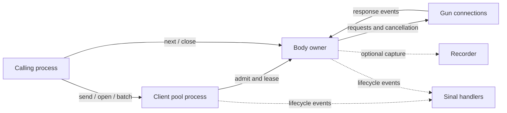

# HTTP Gun

HTTP Gun is a Gleam HTTP client for Erlang/OTP applications. One client gives
you a reusable connection pool, collected or streamed byte responses, explicit
resource limits, and offline playback. Your application decides what a status
or response body means.

## Capabilities

- A client that can be linked to its caller or started under an OTP supervisor;
  per-call views share the same pool.
- Reused HTTP/1.1 connections, optional HTTP/2, verified server TLS, and
  optional client certificate identities.
- Destination policies that check resolved addresses and can narrow a client's
  access by host and address class.
- Collected responses with per-response and batch limits, plus streamed bodies
  with explicit ownership, trailers, and close behavior.
- Ordered batches with a caller-selected concurrency bound.
- Per-call deadlines, request and idle timeouts, and cancellation tokens.
- Typed failures with submission evidence (`NotSent` or `MaybeSent`) and any
  response status and headers already received.
- Ordered offline scripts and local cassette recording, loading, playback, and
  configurable redaction.
- Sinal lifecycle events with request IDs, optional correlation, and client
  labels.

## When to use it

Use HTTP Gun for ordinary API calls in a supervised Erlang application, for
reading large responses a chunk at a time, or for tests that need deterministic
offline responses and recorded exchanges. It is a transport client: provider
adapters still own authentication, status and content interpretation, retries,
protocol framing such as SSE, and reconciliation of external effects.

## Install

HTTP Gun requires Gleam 1.18 or newer on the Erlang target. Add it from Hex:

```sh
gleam add http_gun
```

Commit the application's `gleam.toml` and `manifest.toml` to retain the resolved versions.

## Send a request

This excerpt uses `server`, `local_request`, and `local_config` from the
[complete ordinary consumer](examples/ordinary/src/http_gun_consumer.gleam).
That consumer starts a local fixture and explicitly permits loopback access.

<!-- prettier-ignore-start -->

<!-- snips: examples/ordinary/src/http_gun_consumer.gleam#send-request -->
```gleam
let req = local_request(server())
// The common path: start a client, send, read the collected response, stop.
let assert Ok(client) = http_gun.start(local_config())
let assert Ok(reply) = http_gun.send(client, req)
let assert 200 = reply.response.status
let assert <<"abc":utf8>> = reply.response.body
http_gun.stop(client)
```

<!-- prettier-ignore-end -->

`send` collects the response body up to its configured limit. Statuses such as
404 and 500 are still response data. For a streaming response, scope body cleanup
with `with_response` and read chunks using `body.next`:

<!-- prettier-ignore-start -->

<!-- snips: examples/ordinary/src/usage_views.gleam#stream-body -->
```gleam
let assert Ok(3) = {
  use response <- http_gun.with_response(stream, req, fn(failure) { failure })
  count(response.body, 0)
}
```

<!-- prettier-ignore-end -->

The [consumer source](examples/ordinary/src/usage_views.gleam) includes the
`count` helper and runs this example against a local server.

## Runtime ownership

Each client has a pool process that admits requests and assigns connection
capacity. Each response has a body owner that coordinates the HTTP exchange;
only the process that opened a body may read it. Gun handles HTTP wire
protocols. An optional recorder captures exchanges, and lifecycle events go to
Sinal handlers.



## Operational limits

- The default destination policy admits public addresses and permits plaintext
  HTTP. Local tests must opt into loopback; set the policy to
  `destination.RequireTls` with `destination.with_plaintext` when plaintext
  must be refused.
- The collection limit applies to `send` and `batch`; streaming has separate
  buffering and open-body limits. These limits do not bound all memory used by
  Gun, Cowlib, or the Erlang VM.
- HTTP Gun does not retry automatically. Use failure evidence and request
  idempotency when deciding whether an application retry is safe.
- Cassettes remove common credential headers by default, but unlisted headers,
  query values, and bodies may still be stored. Add redaction for application
  secrets and inspect fixtures before sharing them. Publication is atomic, but
  crash durability is not promised.
- Sinal events are best effort. Without a forwarder route, handlers run inside
  client processes and a slow handler can delay requests.
- Streamed uploads, redirect following, decompression, proxies, cookie/cache
  adapters, and generic SSE framing are not implemented.

## Examples and reference

The [ordinary consumer](examples/ordinary/README.md) runs the public API
examples. See the [async feed recipe](examples/async/README.md) for application
owned jobs and sinks, and the [mTLS consumer](examples/mtls/README.md) for
client identity setup and rotation. The [public API](src/http_gun.gleam),
[design](docs/design/design-layer.pdf), and [coverage map](docs/COVERAGE.md) describe
the package contracts. [Benchmark notes](docs/BENCHMARKS.md) report retained local
workload measurements; they predate this checkout and make no performance
promise.
