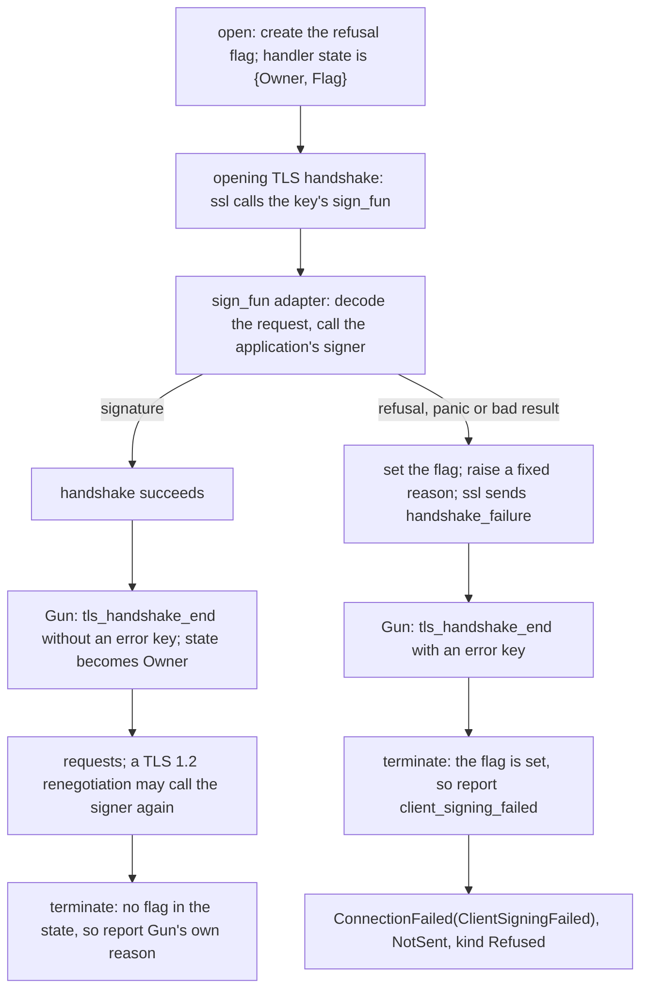

# 0020: Sign client certificates through an application signer

Date: 2026-11-19
Status: Accepted

## Decision

- Add `client_identity.from_signer(certificates, signer)` beside `from_pem`.
  It admits a PEM certificate chain as `from_pem` does and a `Signer` in
  place of a private key. `Signer` names the key kind; `RsaSigner(sign)` is
  the only variant, and `Signer` may gain variants (for example ECDSA) in a
  minor release. `sign` receives an `RsaRequest(message, hash, scheme)` with
  `Hash` (`Sha256`, `Sha384`, `Sha512`) and `RsaScheme` (`RsaPkcs1v15`,
  `RsaPss(salt_length, mgf1_hash)`), both closed, and returns
  `Result(BitArray, Nil)`.
- `Identity` becomes a Gleam opaque type with a PEM snapshot variant and an
  external-signer variant. It stays without public constructors or
  accessors, so `from_pem` and its callers are unchanged.
- OTP's `ssl` calls the key's `sign_fun` in the connection's ssl process.
  One native adapter in `http_gun_ffi` turns the message iodata into a
  binary and calls a Gleam closure that decodes the hash and options into
  the typed request, refusing anything else before the application's
  function runs. The adapter discards any exception and raises one fixed
  reason, which OTP turns into a `handshake_failure` alert.
- A refusal sets a per-connection `atomics` flag created when the connection
  opens. `http_gun_event_h` carries the flag in its state until the opening
  handshake ends. If the handshake fails, it reads the flag when Gun
  terminates and reports the new `TransportCause` variant
  `ClientSigningFailed` instead of the alert, so a failed opening handshake
  is `ConnectionFailed(ClientSigningFailed)` with NotSent. If the handshake
  succeeds, the state drops the flag, and a later termination is reported
  with its own reason.
- `error.kind` classifies `ConnectionFailed(ClientSigningFailed)` and
  `RequestFailed(ClientSigningFailed)` as `Refused`, so `error.is_retryable`
  is false for them whatever the evidence.
- A refusal during a server-initiated TLS 1.2 renegotiation is not
  reclassified. It happens after submission, and OTP closes the socket
  without notifying the owner, so the request ends at its own deadline or
  idle timeout with MaybeSent.

## How it works

The application's signer runs in the connection's ssl process. Only the
adapter sees the message, the signature and any exception; the flag carries
the single fact that the signer did not sign, and only the opening handshake
turns it into a failure cause.

## Rationale and alternatives

- ADR 0011 left hardware-backed signing out of PEM admission because it
  needs its own lifetime and failure contract. This record is that
  contract: an application whose key lives in another service cannot use
  `from_pem` without handing the key to the client process.
- A signer type per key kind keeps RSA signers free of an impossible ECDSA
  case and gives OTP the key algorithm without decoding the certificate. A
  single request type with an ECDSA scheme variant would make every RSA
  signer handle a case it cannot meet. Deriving the kind from the leaf
  certificate would need another native decode and a new `Error` variant,
  which would break exhaustive matches on the published `Error`.
- The request carries only a message. OTP passes a precomputed digest only
  for TLS 1.1 and older, with an MD5/SHA-1 hash no `Hash` value names, and
  OTP 27 to 29 do not negotiate those versions by default; a `Digest`
  variant would be a case no signer could be shown. Such a call is refused.
- The signer returns `Result(BitArray, Nil)`. HTTP Gun acts the same on any
  refusal, so an error type with variants it discards would promise a
  distinction with no behavior; the application already knows why its own
  signer refused.
- A signing failure is `Refused`, not `Network`. The signer returns no
  reason, so HTTP Gun cannot tell a signer that declined from one whose
  signing service was briefly unreachable. Calling the failure retryable
  would advise a caller to open another connection and ask the signer
  again, which repeats a refusal and loads the signer; the application owns
  the signer and can retry when it knows the cause was passing.
- PSS keeps OTP's salt length and MGF1 hash as fields rather than deriving
  them from the hash. Signing services take them as parameters, and HTTP Gun
  passes OTP's values unchanged instead of restating TLS's rule.
- Restricting the client's offered signature algorithms to those a signer
  supports would also restrict which server signatures the client accepts.
  The signer instead refuses what it cannot serve.
- OTP's signing failure yields `{tls_alert, {handshake_failure, Text}}`,
  structurally the same as a server's `handshake_failure`; only the text
  differs. Matching the text would depend on OTP's diagnostic wording.
  Exiting the ssl process instead reaches Gun as `closed`, and throwing
  reaches `gen_statem` as an invalid return. The flag is set before the
  error is raised and read after Gun receives the failed handshake, so the
  event handler reports the cause in order before Gun exits.
- The flag covers only the opening handshake. A refusal during a later
  renegotiation also sets it, and the flag is never cleared, so reading it on
  every termination would report any later end of that connection as a
  signing failure. Dropping the flag when Gun reports a successful
  `tls_handshake_end` keeps the cause truthful without a second flag or a
  reset that could race with a renegotiation in the ssl process.
- Running the signer under a library timer would require a process per
  signature and still could not stop the work the signer started. The
  connect timeout bounds the opening handshake; the signer bounds itself.

## Evidence

- `examples/mtls` keeps the key in a separate actor and runs against a real
  local OTP TLS peer: PKCS#1 v1.5 over TLS 1.2 with a PKCS#1-only
  certificate request, PSS over TLS 1.2 defaults, TLS 1.3 and H2 (each
  SHA-512 with a 64-byte salt on OTP 29), one signature per full handshake,
  none for connection reuse or IP-literal session resumption, another on
  renegotiation, refusal and panic as `ClientSigningFailed` of kind `Refused` and not
  retryable, a mismatched
  key as the server's refusal, a renegotiation refusal ending at the
  request deadline, and a slow signer ending at `ConnectTimeout`.
- One request can cost more than one signature. The pool marks an H2
  connection ready with no stream capacity until the server's first SETTINGS
  arrives, and a ready connection is not one being prepared, so a waiting
  request opens further connections to the origin, up to the per-origin limit
  (four by default); each handshake signs. The consumer requires exactly one
  signature over H1 and at least one over H2.
- OTP 29 `ssl` 11.7.8 source: `ssl_handshake:digitally_signed/5` catches
  `error` and raises a `handshake_failure` alert;
  `tls_dtls_client_connection:host_id/2` registers sessions under the SNI
  name while `tls_client_connection` selects by the connected address; an
  OTP server that verifies clients resumes no session by default
  (`ssl_config:opt_reuse_sessions/3`).
- `test/http_gun_event_handler_test.gleam` drives `http_gun_event_h` with a
  signer identity's state: a set flag after a failed opening handshake is
  reported as `client_signing_failed`, and a flag set after a successful one
  leaves the termination reason unchanged. No public path observes the
  second case today, because the pool ignores the cause of a connection
  that already came up.
- A direct `ssl` client with `{active, once}` receives no `ssl_error` or
  `ssl_closed` message when its own signing fails during a server-initiated
  renegotiation; the socket is simply closed.
